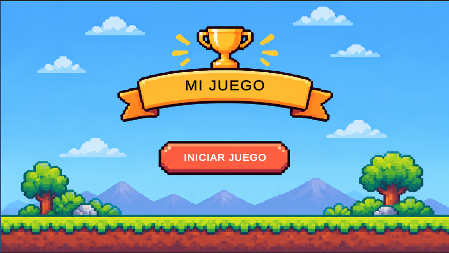
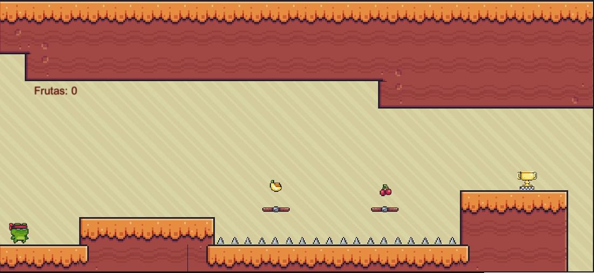
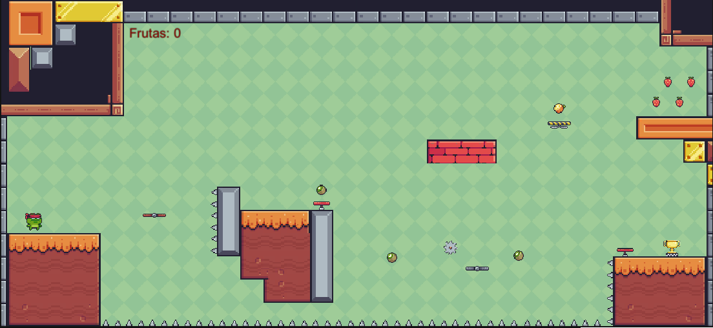
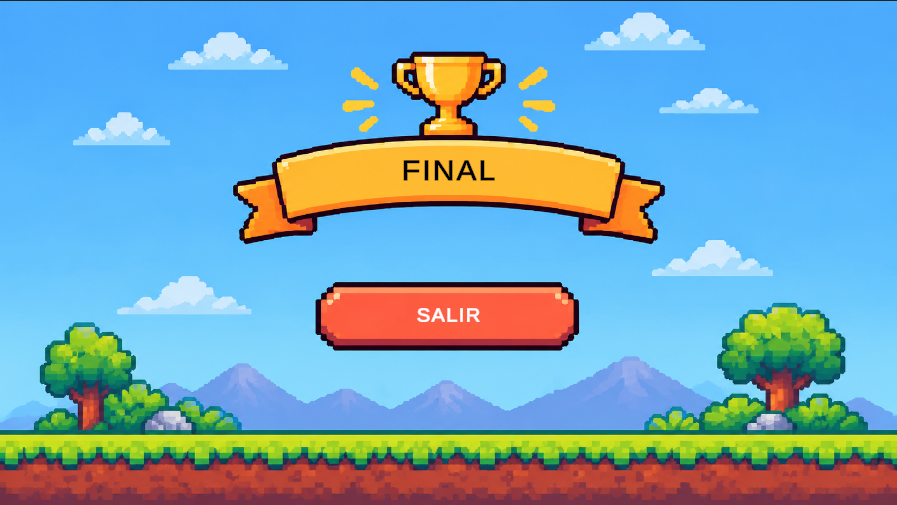

# Proyecto PMDM 2026

# Proyecto PMDM 2026 – Juego 2D

**Autor:** [Jeremy Vasquez Baez]

## Descripción del proyecto

El objetivo del juego es controlar a un personaje que debe superar diferentes niveles, recoger frutas, esquivar obstáculos y trampas, y alcanzar la meta para completar cada nivel.

## Características del juego

- Movimiento horizontal y salto del personaje.
- Animaciones del jugador.
- Diferentes niveles.
- Recogida de frutas y contador de objetos.
- Plataformas móviles.
- Trampas y obstáculos.
- Detección de colisiones.
- Música de fondo persistente entre escenas.
- Efectos de sonido al saltar y recoger frutas.
- Pantalla de inicio y pantalla final.

## Capturas del juego

### Pantalla de inicio

### Nivel 1

### Nivel 2

### Pantalla final

## Tecnologías utilizadas

- Unity 6
- C#
- Rigidbody2D y Collider2D
- Tilemap y Tile Palette
- Canvas y TextMeshPro
- Audio Source y SceneManager